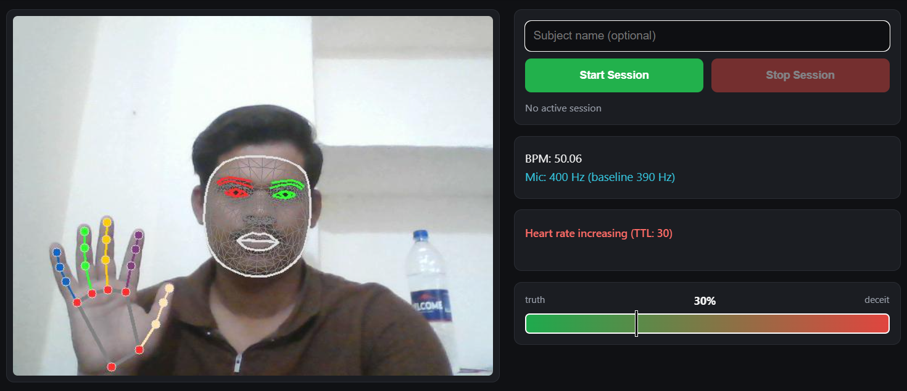
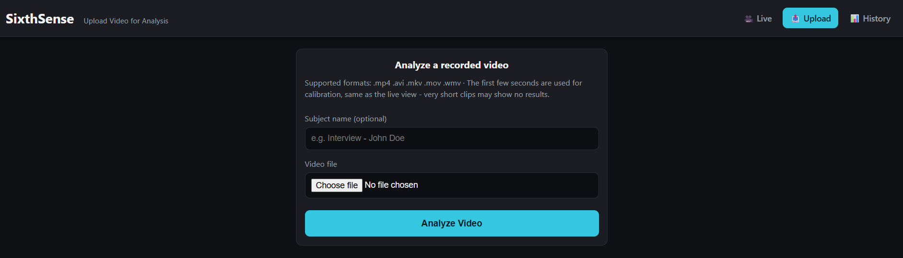
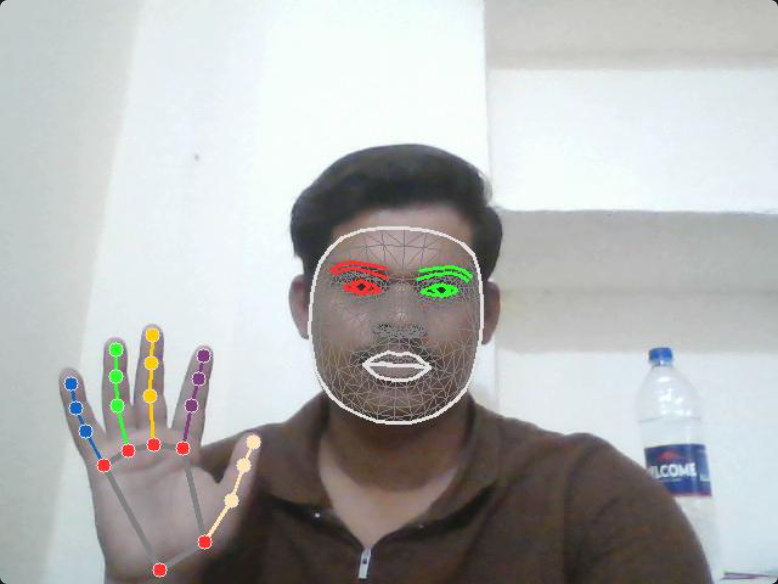

# SixthSense: A Real-Time Remote-Control Deception Detector

> A locally hosted, browser-based prototype that observes pulse, blink, gaze, lip, hand-to-face, facial-expression and voice-pitch indicators from a webcam, microphone or recorded video, and shows each change **relative to the subject's own baseline**.

**B.Tech Project | Department of Computer Science & Engineering | Engineering College Ajmer (Bikaner Technical University) | Session 2026–27**

---

## ⚠️ Important disclaimer

SixthSense is an **experimental educational prototype**. It is **not** a scientifically validated lie detector.
Pulse changes, blinking, gaze shifts, lip pressing, face touching and voice pitch also occur in truthful people who are nervous, tired or concentrating. The on-screen meter is a weighted count of active behavioural indicators, **not** a probability of lying.

Do **not** use this software for legal, employment, academic-disciplinary, financial or medical decisions. Use it only with the informed consent of everyone being observed.

---

## Screenshots

| Live dashboard | Upload page |
|---|---|
|  |  |



---

## Features

- **Live analysis** from a webcam (and microphone) in the browser, with an annotated MJPEG video stream.
- **Recorded-video analysis** (`.mp4`, `.avi`, `.mkv`, `.mov`, `.wmv`), including audio-based voice-pitch analysis.
- **Seven indicators**, each shown separately with a remaining lifetime (TTL):

| Indicator | Method |
|---|---|
| Pulse (rPPG) | Mean cheek-region colour, smoothing, peak detection, BPM (accepted range 50–150) |
| Blink pattern | Eye Aspect Ratio against a personalised threshold |
| Gaze change | Normalised iris offset, recent vs. earlier window (z-score) |
| Lip compression | Lip ratio against a personalised threshold |
| Hand on face | Fingertip landmarks inside the face-oval polygon |
| Facial expression | FER classifier in a background thread (displayed, not scored) |
| Voice pitch | Autocorrelation pitch (75–400 Hz) vs. calibrated baseline |

- **Personal calibration:** the first 120 processed frames learn eye/lip thresholds and the voice baseline.
- **Behavioural meter (0–100%)** built from the weights of the active indicators (heuristic weights, not statistically validated).
- **Session history** stored in MySQL (sessions and first-activation events) with a History page.
- **Local processing:** video and audio are analysed on your own machine; no media is sent to a cloud service.

---

## How it works

```
Webcam / Video file ──► OpenCV frames ──► MediaPipe Face (478) + Hand (21) landmarks
                                                │
                    ┌───────────────────────────┴─────────────────────────────┐
                    ▼                                                         ▼
     Indicators: rPPG, EAR, gaze, lip, hand                    FER thread (expression)
                    │                                    Microphone ──► pitch monitor
                    ▼
        Calibration (120 frames) ──► tells with TTL ──► weighted meter
                    │
                    ▼
   Flask: /video_feed (MJPEG) · /api/tells (JSON) · MySQL session log
```

Threads: `FrameGrabber` (camera) → `DetectionWorker` (landmarks and indicators) → short-lived FER thread → audio callback → Flask request threads. A shared lock protects the analysis state.

---

## Tech stack

Python 3.12 · OpenCV · MediaPipe (Tasks API) · NumPy · SciPy · FER (TensorFlow, PyTorch, facenet-pytorch) · Flask · MySQL (`mysql-connector-python`) · sounddevice · MoviePy

---

## Project structure

```
.
├── app.py                    # Flask app: routes, sessions, upload, history
├── config.py                 # Environment-driven settings
├── camera/stream.py          # Capture/detection/audio start-stop, JSON state, MJPEG
├── detection_pipeline.py     # FrameGrabber and DetectionWorker threads
├── detection_lock.py         # Lock for shared analysis state
├── landmark_detector.py      # MediaPipe Face and Hand Landmarker wrapper
├── deception_detection.py    # Indicators, calibration, FER thread, tells, meter
├── voice_analysis.py         # Autocorrelation pitch, microphone monitor
├── video_upload.py           # Recorded-video analysis
├── database/                 # db.py and schema.sql
├── templates/                # index.html, upload.html, history.html
├── static/                   # css/style.css, js/app.js
├── models/                   # face_landmarker.task, hand_landmarker.task
├── uploads/                  # Uploaded videos (git-ignored)
├── download_models.py        # Fetches the MediaPipe model files
├── setup_windows.bat         # One-time setup helper (Windows)
├── requirements.txt          # Pinned dependencies
└── docs/screenshots/         # Images used in this README
```

---

## Getting started (Windows 10/11)

### Prerequisites

- **Python 3.12 (x64)** (MediaPipe does not yet provide Python 3.13 wheels)
- **MySQL Server** running locally, with an account that can create databases and tables
- A webcam, and optionally a microphone
- About 8 GB RAM (TensorFlow and PyTorch are both loaded by the FER stack)

### 1. Clone and install

```bash
git clone <your-repository-url>
cd <repository-folder>

# automatic setup (creates .venv, installs requirements, downloads models)
setup_windows.bat
```

Manual alternative:

```bash
py -3.12 -m venv .venv
.venv\Scripts\activate
python -m pip install --upgrade pip
pip install -r requirements.txt
python download_models.py
```

### 2. Configure the database

Start MySQL and set the credentials as environment variables (Windows `cmd`):

```bash
set DB_USER=root
set DB_PASSWORD=your_mysql_password
```

The `sixthsense` database and its two tables are created automatically on first start.

### 3. Run

```bash
.venv\Scripts\activate
python app.py
```

Open **http://localhost:5000** in Chrome. The first start is slow because TensorFlow and PyTorch are loaded.

---

## Using the application

1. **Live page:** type an optional subject name and press **Start Session**.
2. Look naturally at the camera (and speak normally) until the *Calibrating…* banner disappears (120 frames).
3. Watch the BPM, microphone pitch, active indicators and the meter. Press **Stop Session** to save the session summary.
4. **Upload page:** choose a recorded video and press **Analyze Video**. Clips must be long enough to finish the 120-frame calibration.
5. **History page:** review past sessions and their indicator events.

**Tips:** keep the camera at eye level, use steady frontal lighting, avoid large head movements, and use a quiet room for voice analysis. Start a new session if lighting or seating changes.

---

## Configuration

| Variable | Default | Meaning |
|---|---|---|
| `DB_HOST` / `DB_PORT` | `localhost` / `3306` | MySQL address |
| `DB_USER` / `DB_PASSWORD` | `root` / *(empty)* | MySQL credentials |
| `DB_NAME` | `sixthsense` | Database name |
| `FLASK_HOST` / `FLASK_PORT` | `0.0.0.0` / `5000` | Web server address |
| `FLASK_DEBUG` | `0` | Set to `1` for Flask debug mode (development only) |
| `CAMERA_INDEX` | `0` | Webcam index used by OpenCV |

> **Security note:** the default host `0.0.0.0` makes the server reachable from other devices on your network, and the app has no authentication. For private use set `FLASK_HOST=127.0.0.1`.

Key analysis constants (in `deception_detection.py`): 120 calibration frames, 50–150 BPM valid range, BPM change threshold 8, indicator TTL 30 frames, eye threshold 0.65 × baseline EAR, lip threshold 0.75 × baseline lip ratio.

---

## REST endpoints

| Route | Method | Purpose |
|---|---|---|
| `/` | GET | Live dashboard |
| `/video_feed` | GET | MJPEG stream of the annotated camera feed |
| `/api/tells` | GET | JSON state: calibration, BPM, mic pitch, active tells, meter |
| `/session/start` | POST | Create a session and restart calibration |
| `/session/stop` | POST | Save end time, average and maximum meter value |
| `/upload` | GET, POST | Analyse a recorded video |
| `/history` | GET | List sessions and their events |

---

## Database

Two tables: `sessions` (id, subject_name, start_time, end_time, avg_confidence, max_confidence) and `tell_events` (id, session_id → sessions.id `ON DELETE CASCADE`, tell_type, tell_text, event_time, confidence_at_event). Only derived data are stored; no video frames or audio are kept in the database.

---

## Limitations

- Pulse estimation uses cheek colour only and is sensitive to lighting flicker and head movement; values are indicative until validated against a pulse oximeter.
- Gaze is measured in 2D image space, so head rotation can look like a gaze change.
- The pitch estimator is limited to 75–400 Hz and is less reliable in noisy rooms.
- Meter weights are heuristic design choices.
- One subject and one analysis state at a time.
- Quantitative accuracy (pulse error, blink precision/recall, false alerts per minute) has not yet been measured.

## Roadmap

Band-pass filtering and CHROM/POS rPPG · head-pose compensation · better pitch estimation and voice features · data-driven indicator fusion on consented data · authentication and per-session state · CSV/JSON export.

---

## Responsible use checklist

- [x] Explain to every participant what is observed and obtain consent.
- [x] Keep processing local; bind the server to `127.0.0.1` unless network access is needed.
- [x] Protect the MySQL account with a password; delete sessions and uploads you no longer need.
- [x] Present results as behavioural indicators, never as proof of deception.

---

## Team

| Name | Roll number |
|---|---|
| Ishwar Lal | 23EEAIT021 |
| Vishvendra | 23EEAIT055 |
| Kunal Dambiwal | 23EEACS047 |

**Supervisor:** Mr. Avinash Bhandiya, Assistant Professor, Department of Computer Science & Engineering, Engineering College Ajmer.

## Acknowledgements

OpenCV, MediaPipe, NumPy, SciPy, FER, Flask, MoviePy and python-sounddevice, and the researchers behind remote photoplethysmography, the Eye Aspect Ratio and cues-to-deception studies.

## License

Academic project. Add a license of your choice (for example MIT) before publishing the repository, and check the licenses of the pre-trained models and libraries you redistribute.
